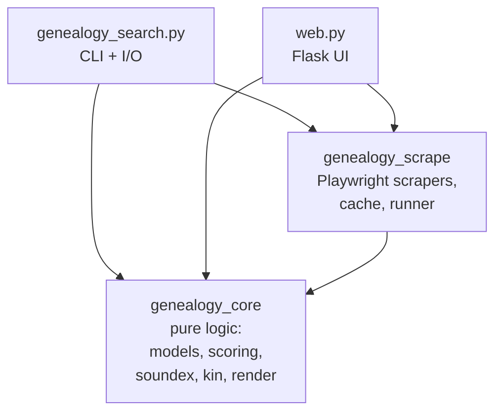

# Irish Genealogy Search

A small Python script that opens a web browser and searches three **free** Irish
family-history sites for the ancestors you list in a spreadsheet. It saves
everything it finds to a CSV file and a tidy HTML summary you can open in any
browser.

The sites it searches:

1. **National Archives of Ireland census**
   <https://nationalarchives.ie/collections/search-the-census/>
   * 1901 and 1911: fully automated.
   * 1926: separate search tool - the results include a direct search link
     you click in your browser.
2. **IrishGenealogy.ie** - civil records *and* church records (both types,
   six event categories: Birth, Marriage, Death, Baptism, Marriage, Burial)
   <https://www.irishgenealogy.ie>
3. **Griffith's Valuation** on Ask About Ireland
   <https://www.askaboutireland.ie/griffith-valuation/> - output is a direct
   search link you click in your own browser (the site sits behind a
   Cloudflare challenge that blocks automated access).

> This is a **personal research tool**. It pauses 5-10 seconds between every
> search and will stop and ask you to solve any CAPTCHA by hand. Please respect
> each site's terms of use and don't run it in a tight loop.

---

## Architecture at a glance



`genealogy_core` has no browser or I/O. `genealogy_scrape` owns everything
browser-ish. `genealogy_search.py` and `web.py` are thin orchestrators.

---

## What you need

* A computer running **Windows 10/11** or **macOS**.
* **Python 3.10 or newer**.
* About 20 minutes the first time you set it up.

You don't need to know any programming.

---

## Step-by-step setup

### 1. Install Python

**Windows**

1. Go to <https://www.python.org/downloads/windows/>.
2. Download the latest "Windows installer (64-bit)".
3. Run the installer. **Tick the box that says "Add python.exe to PATH"** before
   clicking Install Now.
4. When it finishes, open **PowerShell** (press `Win` key, type `powershell`,
   press Enter).
5. Type `python --version` and press Enter. You should see something like
   `Python 3.12.3`.

**Mac**

1. Go to <https://www.python.org/downloads/macos/>.
2. Download and run the macOS installer.
3. Open the **Terminal** app (press `Cmd+Space`, type `terminal`, press Enter).
4. Type `python3 --version` and press Enter. You should see `Python 3.12.x`.

> On Mac, use `python3` and `pip3` everywhere this README says `python` and `pip`.

### 2. Open a terminal in the project folder

**Windows (PowerShell)**

```powershell
cd "C:\Projects\daf-search-free-Irish genealogy websites"
```

**Mac (Terminal)**

```bash
cd ~/Downloads/daf-search-free-Irish-genealogy-websites
```

(Adjust the path to wherever you saved these files.)

### 3. Install Playwright

Copy these two lines into your terminal, one at a time, and press Enter after
each:

```bash
python -m pip install playwright
python -m playwright install chromium
```

The first line installs the Python package. The second downloads a copy of the
Chromium browser (about 150 MB) that the script will drive.

> **Why `python -m` ?** It runs the tool through Python itself, so it works even
> if the `playwright` or `pip` command isn't on your system PATH. If you see
> `'playwright' is not recognized` or `'pip' is not recognized`, use the
> `python -m` form above. On Mac use `python3 -m ...`.

### 4. Edit `ancestors.csv`

`ancestors.csv` is gitignored (it may contain real family data). Copy the
sample to get started:

```bash
cp ancestors.sample.csv ancestors.csv    # Mac/Linux
copy ancestors.sample.csv ancestors.csv  # Windows
```

Open `ancestors.csv` in Excel, Numbers, or any text editor. You will see a
header row and example rows:

```csv
surname,forename,surname_variants,birth_year_approx,year_range,county,notes
Furey,John,Fury;Furey;Fewery,1875,5,Galway,Possibly born near Ballinasloe
Kelly,Mary,Kelley;O'Kelly,1880,7,Mayo,Married in Castlebar area
```

Columns:

| Column | Meaning | Example |
|---|---|---|
| `surname` | Main spelling | `Furey` |
| `forename` | First name (leave blank if unknown) | `John` |
| `surname_variants` | Other spellings, separated by `;` | `Fury;Fewery` |
| `birth_year_approx` | Roughly when they were born | `1875` |
| `year_range` | How many years either side of that to search | `5` |
| `county` | Irish county | `Galway` |
| `townland` | Townland / parish (optional) | `Ballinasloe` |
| `townland_variants` | Other spellings of townland, separated by `;` | `Ballybeg;Ballybeag` |
| `notes` | Anything for your own reference | `Born near Ballinasloe` |

Replace the two example rows with your own ancestors. Save the file as **CSV
(Comma delimited)** - *not* `.xlsx`.

### 5. Run it

```bash
python genealogy_search.py
```

A Chromium browser window will open and the script will start searching. You
can watch it work. When it finishes:

* **`results.csv`** - a spreadsheet of everything found.
* **`results.html`** - open this in your browser for a tidy summary grouped by
  person, with clickable links to each record.
* **`run.log`** - a diary of every search and any errors.

### Useful options

```bash
python genealogy_search.py --headless                    # no visible browser
python genealogy_search.py --input me.csv                # different input file
python genealogy_search.py --skip nai_census             # skip one site
python genealogy_search.py --skip nai_census,griffiths   # skip several
```

Valid site keys for `--skip`: `nai_census`, `irishgenealogy_civil`, `griffiths`.

The script also stops hitting any site that fails to load twice in a row,
so a down site won't eat your whole run.

---

## What happens if something goes wrong?

### A CAPTCHA appears

The script will **pause** and print a message like:

```
*** A CAPTCHA or block page appeared. ***
Please solve it in the browser window, then press ENTER here to continue.
```

Solve the CAPTCHA in the browser window, come back to the terminal, press
**Enter**, and the script will carry on.

### A site times out repeatedly

If every attempt to a given site logs `ERR_CONNECTION_TIMED_OUT`:

1. Open the site in your normal browser. If **the browser also hangs**,
   the site is down or unreachable from your network - nothing the script
   can fix. Wait and retry later, or try a VPN.
2. If the browser loads the site fine but the script keeps timing out,
   your antivirus or firewall may be blocking the headless Chromium. Add
   an exception, or run with a VPN off.
3. To carry on with the other sites in the meantime, skip the broken one:

   ```bash
   python genealogy_search.py --skip nai_census
   ```

### A site's layout has changed

Websites change. If one site stops returning results, the script logs an error
for *that site* and keeps going with the other two. Check `run.log` for details.

To fix a broken site yourself:

1. Open `genealogy_search.py` in any text editor.
2. Near the top is a block labelled **CONFIG**. Find the entry in `SITES` for
   the broken site.
3. Visit the site manually, do a search, and look at the URL in your browser's
   address bar. Update the `search_url` template so its `{placeholders}` match
   the real parameters.
4. If needed, update the `results_table` and `results_row` CSS selectors by
   right-clicking a result in your browser and choosing **Inspect**.

You never have to touch the search logic further down the file.

### Python says "command not found"

You skipped ticking "Add python.exe to PATH" during install. Reinstall Python
and tick that box, or on Mac use `python3` instead of `python`.

### `pip install` fails or `playwright` not recognized

Use the module form, which does not depend on PATH:

```bash
python -m pip install playwright
python -m playwright install chromium
```

### Nothing found at all

* Double-check the county spelling (use the standard Irish county name, e.g.
  `Galway`, `Mayo`, `Dublin`, `Antrim`).
* Widen `year_range` to 10 or 15.
* Add more spelling variants in `surname_variants`.

---

## A note on etiquette

These three sites are free gifts to the genealogy community, run by public
bodies and charities. Please:

* Don't remove the delay between searches.
* Don't try to bypass any CAPTCHA.
* Don't run the script repeatedly for the same people - cache the results you
  already have.
* Click through and read the actual records on the site; the script only finds
  candidate matches.

Happy ancestor-hunting.
